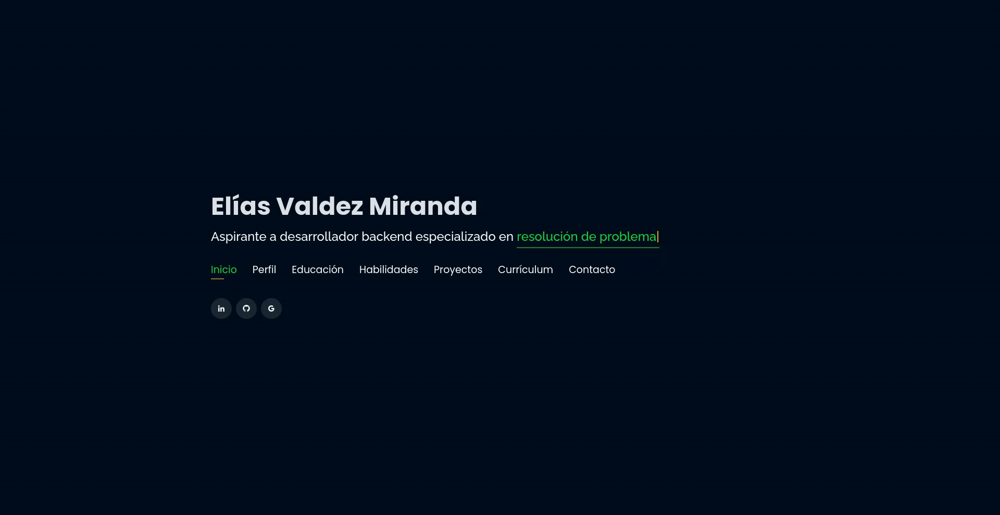
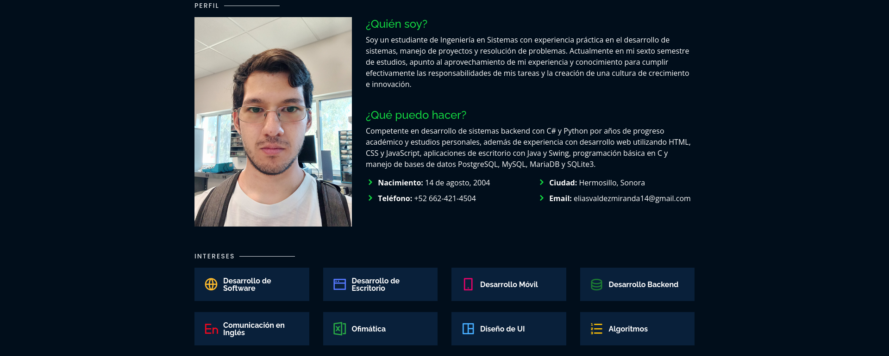
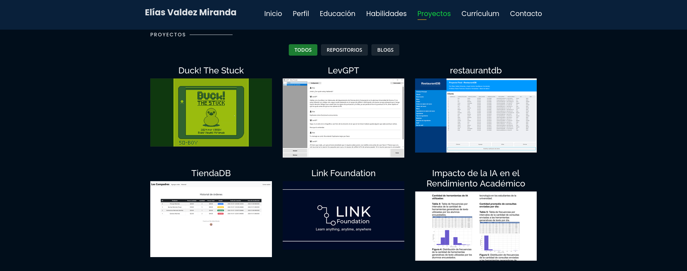

    
  <h1 align="center">Portafolio personal</h1>
  <h4 align="center">Portafolio en línea de Elías Valdez Miranda</h4>
  <h4 align="center"><a href="https://eliasvaldezmiranda.github.io/">Revisa el portafolio aquí</a></h4>

## 📢 Origen del Portafolio 
- Este portafolio es una modificación del portafolio desarrollado y compartido por [Prerak Raja](https://github.com/rajaprerak), cuyo repositorio se puede encontrar [aquí](https://github.com/rajaprerak/rajaprerak.github.io.git).

## 🔎 Previsualización del Sitio
### Página de inicio

### Página de perfil

### Página de proyectos

  
## 📋 Características
⚡️ Completamente responsivo\
⚡️ HTML5 y CSS3 válido\
⚡️ Animación de escritura utilizando `Typed.js`\
⚡️ Fácil de modificar

## 📦 Instalación y Despliegue
- Clona el repositorio y modifica el contenido de <b>index.html</b> 
- Agrega o elimina imágenes del directorio `assets/img/` de acuerdo con tus necesidades.
- Actualiza la información del directorio `projects` de acuerdo con tus necesidades.
- Utiliza [Github Pages](https://create-react-app.dev/docs/deployment/#github-pages) para crear tu propio sitio web.
- Para desplegar tu sitio web, primero necesitarás crear un repositorio de GitHub con le nombre `<tu-nombre-de-usuario-de-github>.github.io` y subir el código generado a la rama `main`.

## 📚 Secciones
✔️ Perfil\
✔️ Educación\
✔️ Habilidades\
✔️ Proyectos\
✔️ Currículum\
✔️ Contacto\

## 🛠️ Herramientas utilizadas
* <b>GitHub Pages</b> - Alojamiento del sitio estático (HTML, CSS, JS).

## ⚖️ Licencia

- **[Licencia MIT](http://opensource.org/licenses/mit-license.php)**
